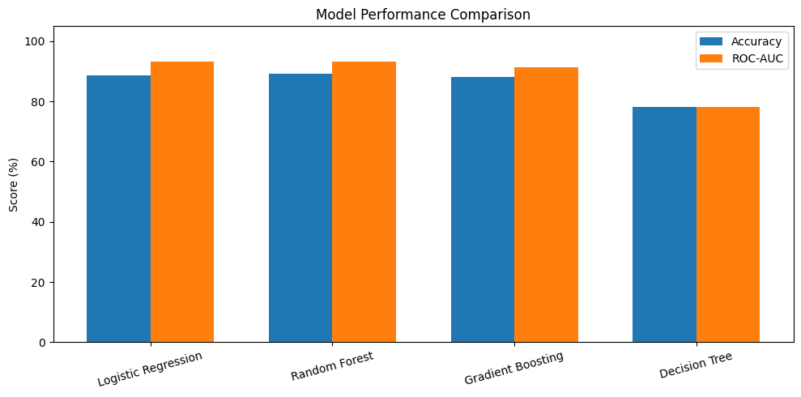
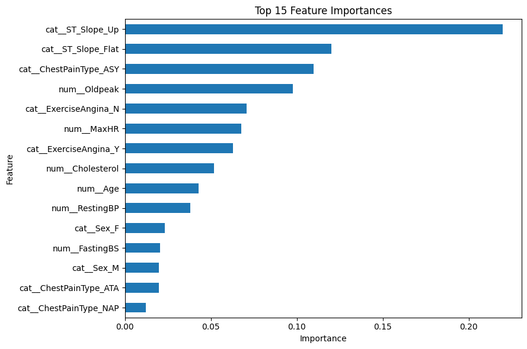
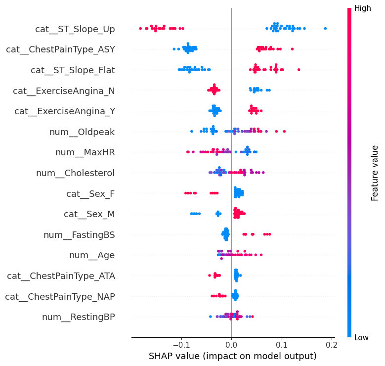

# Heart Disease Prediction Using Machine Learning

## Overview

This project focuses on predicting the likelihood of heart disease using machine learning classification algorithms. It includes exploratory data analysis, data preprocessing, model comparison, hyperparameter tuning, cross-validation, and model interpretability using SHAP.

The objective is to build and evaluate a machine learning pipeline that can identify patterns associated with heart disease in patient data.

## Dataset

The dataset contains 918 records and 12 columns, including:

- Age
- Sex
- ChestPainType
- RestingBP
- Cholesterol
- FastingBS
- RestingECG
- MaxHR
- ExerciseAngina
- Oldpeak
- ST_Slope
- HeartDisease (Target)

The target variable is binary:
- `0` – No heart disease
- `1` – Heart disease

## Technologies Used

- Python
- Pandas
- NumPy
- Scikit-learn
- Matplotlib
- Seaborn
- SHAP
- Joblib
- Google Colab

## Project Workflow

1. Data loading and exploratory data analysis
2. Data cleaning and preprocessing
3. Categorical feature encoding
4. Numerical feature scaling
5. Train-test splitting
6. Training multiple classification models
7. Model comparison
8. Cross-validation
9. RandomizedSearchCV hyperparameter tuning
10. Feature importance analysis
11. SHAP explainability
12. Saving the final trained pipeline

## Models Evaluated

- Logistic Regression
- Decision Tree
- Random Forest
- Gradient Boosting

Random Forest was selected for further hyperparameter tuning.

## Model Performance

### Initial Model Comparison

| Model | Accuracy | ROC-AUC |
|---|---:|---:|
| Logistic Regression | 88.59% | 93.34% |
| Random Forest | 89.13% | 93.24% |
| Gradient Boosting | 88.04% | 91.38% |
| Decision Tree | 78.26% | 78.24% |

### Final Tuned Random Forest

The Random Forest model was optimized using RandomizedSearchCV with ROC-AUC as the scoring metric.

**Cross-validation results:**

| Metric | Score |
|---|---:|
| Accuracy | 85.56% |
| Precision | 85.24% |
| Recall | 89.92% |
| F1-Score | 87.37% |
| ROC-AUC | 93.27% |

**Held-out test results:**

| Metric | Score |
|---|---:|
| Accuracy | 88.04% |
| ROC-AUC | 92.73% |
| Class 1 Recall | 92.16% |

## Model Interpretability

SHAP (SHapley Additive exPlanations) was used to understand how individual features influence the model's predictions.

Feature importance analysis highlighted features such as:

- ST_Slope
- ChestPainType
- Oldpeak
- ExerciseAngina
- MaxHR
- Cholesterol
- Age

These results describe the model's learned patterns and do not establish medical causation.
## Visual Results

### 1. Model Performance Comparison

Comparison of Accuracy and ROC-AUC scores across four classification models.



### 2. Confusion Matrix

Visual representation of the final tuned Random Forest model's predictions.


### 3. Feature Importance

The most influential features identified by the Random Forest model.



### 4. SHAP Summary Plot

SHAP visualization showing how different features influence model predictions.



## Repository Structure

```text
heart-disease-prediction/
│
├── Heart_Disease_Prediction.ipynb
├── heart_disease_model.joblib
├── requirements.txt
└── README.md
```

## How to Run

1. Clone the repository:

```bash
git clone https://github.com/Harshawasthi01/heart-disease-prediction.git
```

2. Navigate to the project directory:

```bash
cd heart-disease-prediction
```

3. Install dependencies:

```bash
pip install -r requirements.txt
```

4. Open the notebook in Jupyter Notebook or Google Colab.

5. Provide the dataset file `heart.csv` and run the notebook cells.

The trained model pipeline is available as `heart_disease_model.joblib`.

## Future Improvements

- Test additional machine learning algorithms.
- Explore advanced hyperparameter optimization.
- Improve model generalization on independent datasets.
- Develop an interactive prediction interface.
- Evaluate performance on more diverse datasets.

## Disclaimer

This project is developed for educational and machine learning research purposes. It is not a clinically validated diagnostic system and must not be used as a substitute for professional medical advice or diagnosis.

## Author

**Tanu Sharma**

B.Tech – Computer Science and Artificial Intelligence & Machine Learning

GitHub: [tanuH14](https://github.com/tanuH14)
